# Mini-projet BI : entrepôt de données et processus ETL

Étude de cas ETL réalisée dans le cadre du module **Business Intelligence** (Master TEE, École Normale Supérieure de Marrakech, Université Cadi Ayyad, année universitaire 2026-2027).

**Auteur :** Marouane Chafiqi

## Contexte

Une université gère ses inscriptions avec plusieurs sources de données séparées, redondantes et parfois incohérentes. Obtenir un indicateur simple (par exemple le nombre d'inscriptions par filière et par région) demande de longues requêtes manuelles.

Ce projet construit un **entrepôt de données en étoile** (MySQL) et l'alimente avec un **processus ETL** (Talaxie Open Studio for Data Integration) à partir de trois fichiers Excel.

## Technologies

| Outil | Version | Rôle |
|---|---|---|
| Talaxie Open Studio for Data Integration | 8.9.0 | Outil ETL (fork communautaire de Talend Open Studio) |
| Java (Temurin) | 21 | Requis par Talaxie 8.9.0 |
| MySQL (via WAMP) | 8 | Entrepôt de données |
| phpMyAdmin | - | Contrôle et requêtes |

> Talend Open Studio n'est plus distribué officiellement depuis janvier 2024. Talaxie reprend la même interface et les mêmes composants (`tFileInputExcel`, `tMap`, `tUniqRow`, `tDBOutput`...).

## Sources de données

| Fichier | Lignes | Colonnes |
|---|---|---|
| `Etudiants.xlsx` | 100 | id_etudiant, nom, prenom, sexe, date_naissance, ville, region |
| `Filieres.xlsx` | 10 | id_filiere, nom_filiere, departement, niveau, type |
| `Inscriptions_2024.xlsx` | 100 | id_inscription, id_etudiant, id_filiere, date_inscription, statut, montant_paye |

Les inscriptions datent toutes de septembre-octobre 2024.

## Modèle de données

Schéma en étoile : **5 dimensions** et **1 table de faits**. Le grain du fait est une inscription par ligne.

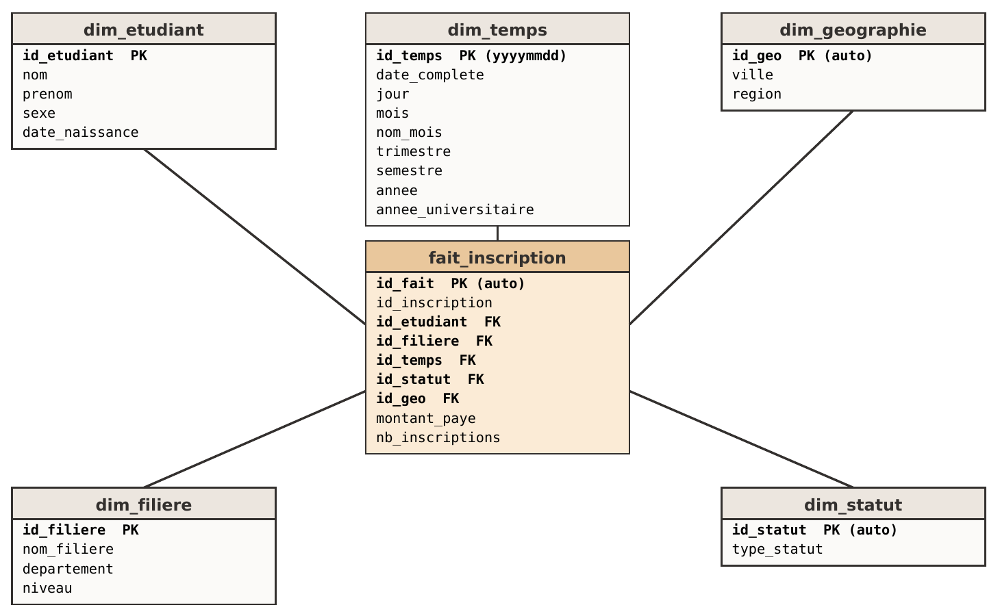

*Figure 1 : schéma en étoile de l'entrepôt*

| Table | Contenu |
|---|---|
| `dim_etudiant` | id_etudiant, nom, prenom, sexe, date_naissance |
| `dim_geographie` | id_geo (auto), ville, region |
| `dim_filiere` | id_filiere, nom_filiere, departement, niveau |
| `dim_temps` | id_temps (yyyymmdd), date_complete, jour, mois, nom_mois, trimestre, semestre, annee, annee_universitaire |
| `dim_statut` | id_statut (auto), type_statut (Inscrit, Redoublant, Désisté) |
| `fait_inscription` | id_fait, id_inscription, clés vers les 5 dimensions, montant_paye, nb_inscriptions |

### Script de création

```sql
CREATE DATABASE IF NOT EXISTS dw_universite
  CHARACTER SET utf8mb4 COLLATE utf8mb4_general_ci;
USE dw_universite;

CREATE TABLE dim_etudiant (
  id_etudiant INT PRIMARY KEY,
  nom VARCHAR(50),
  prenom VARCHAR(50),
  sexe CHAR(1),
  date_naissance DATE
);

CREATE TABLE dim_geographie (
  id_geo INT AUTO_INCREMENT PRIMARY KEY,
  ville VARCHAR(50),
  region VARCHAR(60)
);

CREATE TABLE dim_filiere (
  id_filiere INT PRIMARY KEY,
  nom_filiere VARCHAR(60),
  departement VARCHAR(40),
  niveau VARCHAR(20)
);

CREATE TABLE dim_temps (
  id_temps INT PRIMARY KEY,
  date_complete DATE,
  jour INT,
  mois INT,
  nom_mois VARCHAR(20),
  trimestre INT,
  semestre VARCHAR(10),
  annee INT,
  annee_universitaire VARCHAR(20)
);

CREATE TABLE dim_statut (
  id_statut INT AUTO_INCREMENT PRIMARY KEY,
  type_statut VARCHAR(20)
);

CREATE TABLE fait_inscription (
  id_fait INT AUTO_INCREMENT PRIMARY KEY,
  id_inscription INT,
  id_etudiant INT,
  id_filiere INT,
  id_temps INT,
  id_statut INT,
  id_geo INT,
  montant_paye DECIMAL(10,2),
  nb_inscriptions INT DEFAULT 1,
  FOREIGN KEY (id_etudiant) REFERENCES dim_etudiant(id_etudiant),
  FOREIGN KEY (id_filiere)  REFERENCES dim_filiere(id_filiere),
  FOREIGN KEY (id_temps)    REFERENCES dim_temps(id_temps),
  FOREIGN KEY (id_statut)   REFERENCES dim_statut(id_statut),
  FOREIGN KEY (id_geo)      REFERENCES dim_geographie(id_geo)
);
```

## Processus ETL

Chaque table a son propre job Talaxie, ce qui permet de localiser une erreur et de relancer un seul job.

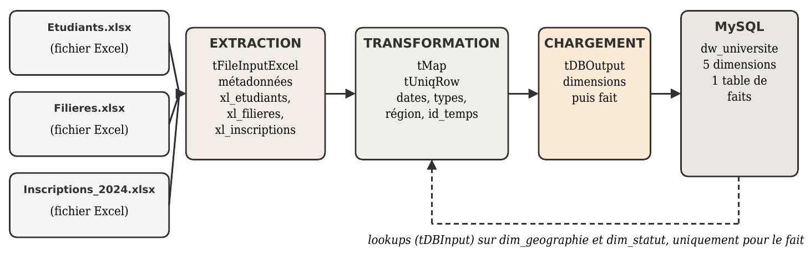

*Figure 2 : flux Extraction → Transformation → Chargement*

| Job | Rôle |
|---|---|
| `Job_Dim_Filiere` | Charge les 10 filières |
| `Job_Dim_Etudiant` | Charge les 100 étudiants |
| `Job_Dim_Geographie` | Recalcule la région depuis la ville, dédoublonne, charge 10 lignes |
| `Job_Dim_Statut` | Valeurs distinctes du statut (3 lignes) |
| `Job_Dim_Temps` | Construit la dimension temps depuis les dates d'inscription (30 dates distinctes) |
| `Job_Fait_Inscription` | Charge le fait : jointure avec les étudiants pour la ville, lookups sur `dim_geographie` et `dim_statut`, calcul de `id_temps` |

### Captures des jobs

| | |
|---|---|
| 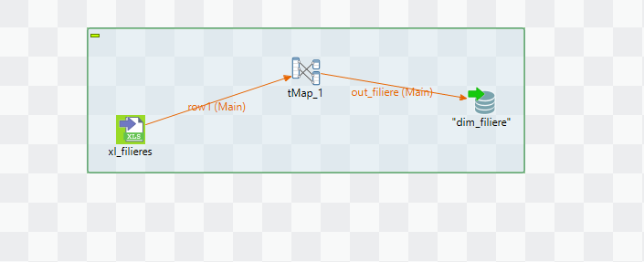 | 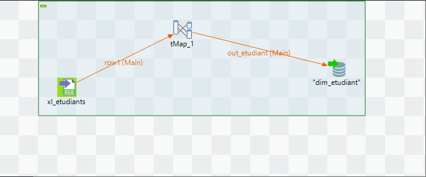 |
| *Figure 3 : Job_Dim_Filiere* | *Figure 4 : Job_Dim_Etudiant* |
| 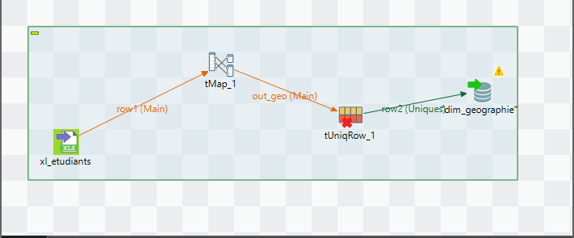 | 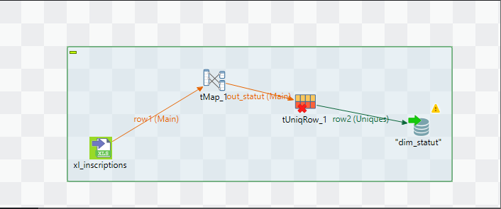 |
| *Figure 5 : Job_Dim_Geographie* | *Figure 6 : Job_Dim_Statut* |

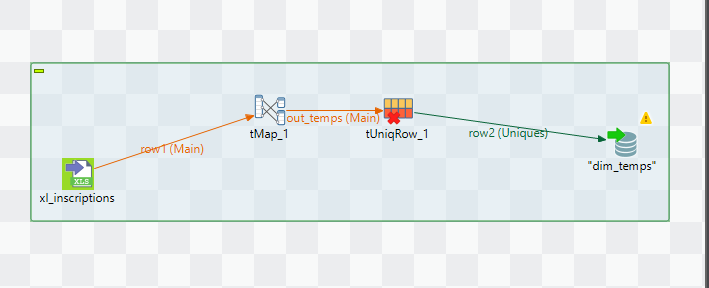

*Figure 7 : Job_Dim_Temps*

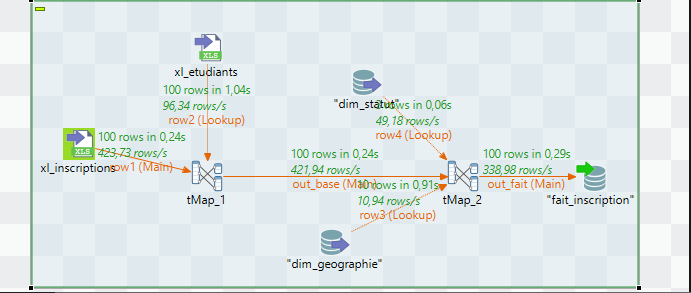

*Figure 8 : Job_Fait_Inscription. Le flux principal `xl_inscriptions` est joint à `xl_etudiants` dans `tMap_1`, puis `tMap_2` fait les lookups sur `dim_geographie` et `dim_statut`.*

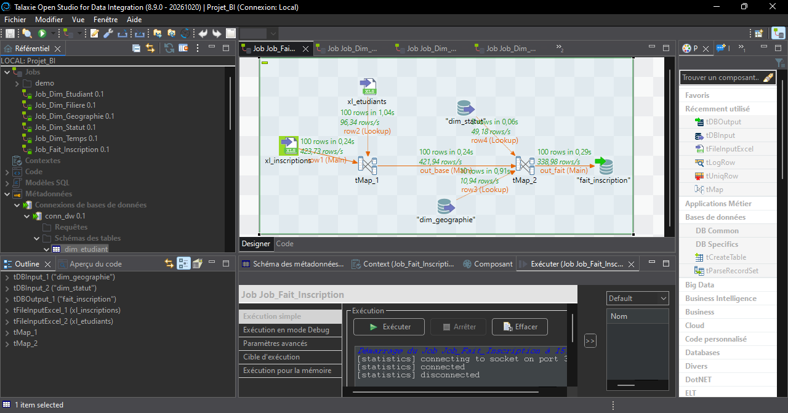

*Figure 9 : exécution du job du fait, 100 lignes lues et 100 lignes écrites*

### Transformations principales

| Problème constaté | Décision | Composant |
|---|---|---|
| 83 étudiants sur 100 ont une région qui ne correspond pas à leur ville | Recalculer la région à partir de la ville | tMap + tUniqRow |
| Filière 9 (Biologie) : niveau = Licence mais type = Master | Alimenter `niveau` avec la colonne `type` | tMap |
| Dates lues comme du texte | Déclarer le type Date (`yyyy-MM-dd`) dans le schéma Built-in | tFileInputExcel |
| Types incompatibles (sexe en Character) | Conversion en String | tMap |
| Pas de dimension temporelle dans les sources | La construire depuis la date d'inscription | tMap + tUniqRow |
| Villes, statuts, dates répétés | Dédoublonner les dimensions | tUniqRow |
| 8 couples (étudiant, filière) répétés (15 lignes) | Conserver : une ligne = une inscription | aucun |
| 23 inscriptions avec `montant_paye = 0` | Conserver tel quel, sans inventer de montant | aucun |

Correspondance ville → région utilisée : Rabat et Kenitra → Rabat-Salé ; Marrakech → Marrakech-Safi ; Fès et Meknès → Fès-Meknès ; Casablanca → Casablanca-Settat ; Tétouan et Tanger → Tanger-Tétouan-Al Hoceima ; Oujda → Oriental ; Agadir → Souss-Massa.

La clé de `dim_temps` est calculée ainsi, dans `Job_Dim_Temps` comme dans `Job_Fait_Inscription` :

```java
Integer.parseInt(TalendDate.formatDate("yyyyMMdd", date_inscription))
```

Les taux ne sont pas stockés dans l'entrepôt : un pourcentage ne s'additionne pas. Ils sont calculés au moment de la requête.

## Installation et exécution

1. Installer **Java 21** et vérifier avec `java -version` (la version affichée doit être 21).
2. Installer **WAMP** (MySQL 8) et démarrer les services.
3. Dans phpMyAdmin, exécuter le script de création ci-dessus.
4. Installer **Talaxie Open Studio for Data Integration 8.9.0** et créer un projet.
5. Dans le Référentiel, créer la connexion `conn_dw` : MySQL, serveur `127.0.0.1`, port `3306`, utilisateur `root`, mot de passe vide, base `dw_universite`. Installer le pilote MySQL proposé par Talaxie, puis récupérer le schéma des 6 tables.
6. Créer les métadonnées Fichier Excel `xl_etudiants`, `xl_filieres`, `xl_inscriptions` en pointant vers les trois fichiers, avec « ligne d'en-tête comme noms de colonnes ».
7. Pour chaque job, passer les dates en type Date (`yyyy-MM-dd`) dans le schéma Built-in de la source Excel.
8. Exécuter les jobs **dans cet ordre** (les dimensions avant le fait, car le fait référence les dimensions) :
   `Job_Dim_Filiere`, `Job_Dim_Etudiant`, `Job_Dim_Geographie`, `Job_Dim_Statut`, `Job_Dim_Temps`, puis `Job_Fait_Inscription`.

> **Rejouer un chargement :** relancer un job sans vider sa table insère les lignes une deuxième fois. Avant un nouveau chargement complet, vider les tables :
> ```sql
> SET FOREIGN_KEY_CHECKS = 0;
> TRUNCATE fait_inscription;
> TRUNCATE dim_etudiant;
> TRUNCATE dim_filiere;
> TRUNCATE dim_geographie;
> TRUNCATE dim_statut;
> TRUNCATE dim_temps;
> SET FOREIGN_KEY_CHECKS = 1;
> ```

> Dans tous les composants `tDBOutput`, laisser « Action sur la table » sur **Par défaut**. L'option « Supprimer et créer la table » recrée les tables avec des types et longueurs inadaptés (erreur `Data too long for column`) et supprime les clés primaires.

## Vérification du chargement

Effectifs après chargement : `dim_filiere` 10, `dim_etudiant` 100, `dim_geographie` 10, `dim_statut` 3, `dim_temps` 30, `fait_inscription` 100 (0 clé étrangère manquante).

| | |
|---|---|
| 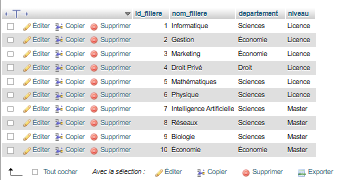 | 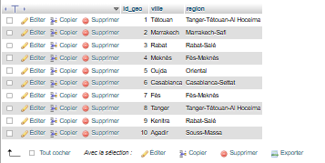 |
| *Figure 10 : `dim_filiere` (Biologie en Master)* | *Figure 11 : `dim_geographie` (régions corrigées)* |

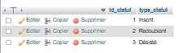

*Figure 12 : `dim_statut`*

| | |
|---|---|
| 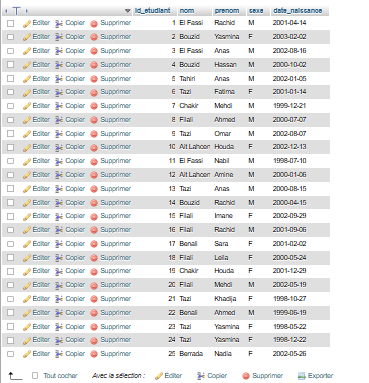 | 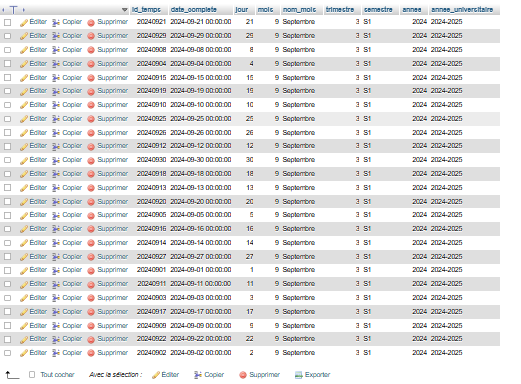 |
| *Figure 13 : `dim_etudiant` (extrait)* | *Figure 14 : `dim_temps` (extrait)* |

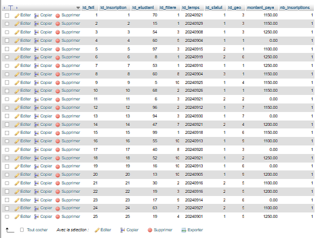

*Figure 15 : `fait_inscription` (extrait)*

## Résultats

### Inscriptions par filière

```sql
SELECT f.nom_filiere, f.niveau, COUNT(*) AS nb_inscriptions
FROM fait_inscription fi
JOIN dim_filiere f ON fi.id_filiere = f.id_filiere
GROUP BY f.nom_filiere, f.niveau
ORDER BY nb_inscriptions DESC;
```

Economie arrive en tête (15), suivie de Marketing et Biologie (13 chacune). Physique n'en compte que 2.

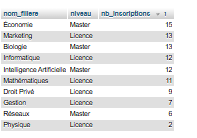

*Figure 16 : inscriptions par filière*

### Inscriptions par région

```sql
SELECT g.region, COUNT(*) AS nb_inscriptions
FROM fait_inscription fi
JOIN dim_geographie g ON fi.id_geo = g.id_geo
GROUP BY g.region
ORDER BY nb_inscriptions DESC;
```

Rabat-Salé domine (26), devant Fès-Meknès (19) et Marrakech-Safi (16). Souss-Massa ferme la liste avec 3 inscriptions. Ce résultat n'est fiable que grâce à la correction des régions.

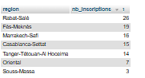

*Figure 17 : inscriptions par région*

### Taux de redoublement global

```sql
SELECT ROUND(100 * SUM(s.type_statut = 'Redoublant') / COUNT(*), 2) AS taux_redoublement_pct
FROM fait_inscription fi
JOIN dim_statut s ON fi.id_statut = s.id_statut;
```

Résultat : **17 %** (17 inscriptions sur 100, désistés inclus).

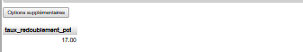

*Figure 18 : taux de redoublement global*

### Inscriptions par année universitaire et semestre

```sql
SELECT t.annee_universitaire, t.semestre, COUNT(*) AS nb_inscriptions,
       SUM(fi.montant_paye) AS total_paye
FROM fait_inscription fi
JOIN dim_temps t ON fi.id_temps = t.id_temps
GROUP BY t.annee_universitaire, t.semestre;
```

Une seule ligne : 2024-2025, S1, 100 inscriptions, 90 600 payés.

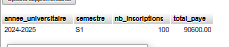

*Figure 19 : inscriptions par année universitaire et semestre*

### Contrôle du chargement

```sql
SELECT COUNT(*) AS total_fait,
       SUM(id_geo IS NULL OR id_statut IS NULL OR id_temps IS NULL) AS cles_manquantes
FROM fait_inscription;
```

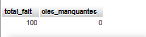

*Figure 20 : contrôle du nombre de lignes et des clés manquantes*


